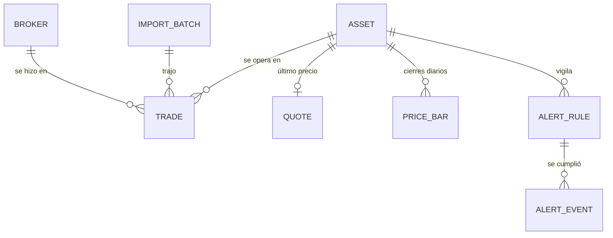
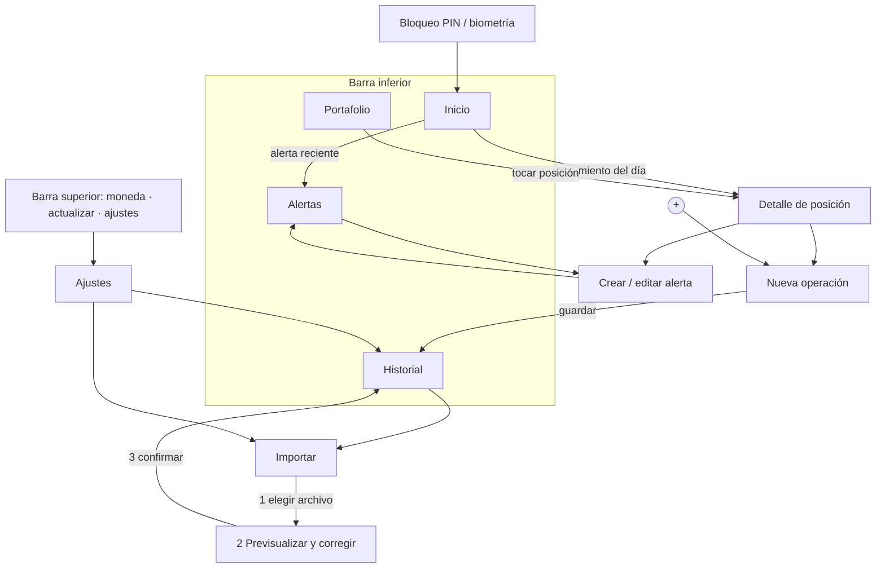

# Inversiones — diseño

App personal para seguir inversiones, recibir alertas y registrar operaciones.
**Solo informa y registra: nunca ejecuta órdenes ni guarda credenciales de brokers.**

Alcance: acciones/ETF de EE.UU. y acciones chilenas; importación desde XTB, Zesty y Racional;
un solo dispositivo; backend mínimo solo para alertas.

## 1. Stack propuesto

| Capa | Elección | Por qué |
|---|---|---|
| App | **PWA** con React + TypeScript + Vite | Un solo código para Android e iOS, sin tiendas ni cuentas de desarrollador. Se instala desde el navegador. |
| Datos locales | **IndexedDB**, un solo documento cifrado | Funciona sin conexión. Todo el estado se cifra junto: más simple que cifrar campo a campo y no deja nada legible. Sin librerías. |
| Cifrado | **WebCrypto** AES-GCM 256, clave derivada del PIN (PBKDF2, 600.000 iteraciones) | Estándar del navegador, sin librerías. La biometría (WebAuthn + PRF) desbloquea la misma clave. |
| Backend | **Un Worker con cron** (p. ej. Cloudflare Workers + D1) | Solo para lo que el celular no puede hacer con la app cerrada: revisar precios y enviar push/correo/Telegram. |
| Cotizaciones | El Worker actúa de proxy hacia el proveedor | Evita CORS, esconde la API key y permite cambiar de proveedor sin tocar la app. |

Lo que queda **fuera** a propósito: router, librería de gráficos, gestor de estado. Con 8 pantallas no hacen falta.

**Límites conocidos de una PWA** (para decidir con información):
- En iOS las notificaciones push solo funcionan si la app está instalada en la pantalla de inicio (iOS 16.4+).
- iOS puede borrar el almacenamiento de una PWA que no se usa en semanas. Por eso el respaldo cifrado exportable es obligatorio, no opcional.
- Si alguno de estos límites molesta en la práctica, el mismo código se empaqueta con Capacitor como app nativa, sin reescribir.

**Por verificar antes de la fase 2:** qué proveedor de cotizaciones cubre la Bolsa de Santiago en su plan gratuito
(EE.UU. es fácil; Chile suele venir con retraso o ser de pago), y el formato real de exportación de XTB, Zesty y Racional
(necesito un archivo de muestra de cada uno).

## 2. Modelo de datos

### En el dispositivo (cifrado)

**asset** — catálogo de activos
| Campo | Tipo | Nota |
|---|---|---|
| id | texto | Símbolo: `AAPL`, `SQM-B` |
| name | texto | |
| type | `accion` \| `etf` \| `indice` \| `divisa` \| `otro` | Para la distribución por tipo |
| exchange | texto | `NASDAQ`, `Bolsa de Santiago`… define el horario de mercado |
| currency | `CLP` \| `USD` | Moneda en que cotiza |
| providerSymbol | texto | Símbolo en el proveedor de precios (fase 2) |

**broker** — `id`, `name`.

**trade** — una fila por compra o venta. Es la única fuente de verdad: posiciones y ganancias se calculan desde aquí.
| Campo | Tipo | Nota |
|---|---|---|
| id | texto | |
| date | fecha | |
| assetId, brokerId | ref | |
| side | `compra` \| `venta` | |
| quantity, price | número | |
| fee, tax | número | Comisión e impuestos, en la moneda de la operación |
| currency | `CLP` \| `USD` | |
| fxRate | número | CLP por USD **en la fecha de la operación** |
| note | texto | |
| importBatchId | ref opcional | Si vino de un archivo |
| fingerprint | texto | `fecha\|activo\|tipo\|cantidad\|precio\|broker`; índice único contra duplicados |

**import_batch** — `id`, `brokerId`, `fileName`, `fileHash`, `importedAt`, `rowCount`.
El hash avisa si se sube el mismo archivo; la huella por fila evita el duplicado aunque el archivo cambie de nombre.

**quote** — `assetId`, `price`, `prevClose`, `asOf`. Último precio guardado, lo que se muestra sin conexión.

**price_bar** — `assetId`, `date`, `close`. Cierres diarios para medias móviles e indicadores (fase 2).

**alert_rule**
| Campo | Tipo | Nota |
|---|---|---|
| id, assetId | | |
| kind | `precio_sobre` \| `precio_bajo` \| `cruce_medias` \| `variacion_dia` \| `indicador` | |
| level / pct / fast, slow / indicator, op, threshold | número | Parámetros según `kind` |
| channels | lista de `push` \| `correo` \| `telegram` | |
| muted | booleano | |

**alert_event** — `id`, `ruleId`, `assetId`, `triggeredAt`, `value`, `message` (la regla tal como era al cumplirse).

**settings** — moneda de visualización, último broker y moneda usados, intervalo de actualización, tema, minutos para el bloqueo automático, canales.

Todo lo anterior se guarda como **un único documento JSON cifrado** en IndexedDB (ver sección 4). Las «tablas» son
colecciones dentro de ese documento.

### Lo que NO se guarda

Posiciones, precio promedio y ganancias **no son tablas**: se recalculan desde `trade`. Así corregir o borrar una operación
antigua nunca deja el portafolio inconsistente.

### Reglas de cálculo

- **Costo promedio ponderado** por activo. Las comisiones e impuestos de compra suman al costo; los de venta restan del ingreso.
- **Ganancia realizada** de una venta = ingreso neto − (costo promedio × cantidad vendida).
- **Dos monedas:** cada monto se convierte con el `fxRate` de su propia operación; el valor actual, con el dólar de hoy.
  Por eso la ganancia en CLP de una acción en USD incluye lo que se ganó o perdió por el tipo de cambio.
- **Desde el inicio** = ganancia no realizada + realizada, sobre el total invertido en compras.

### En el servidor (lo mínimo)

Solo `alert_rule` (símbolo, condición, canales), la suscripción push del dispositivo y los `alert_event` generados.
**El servidor nunca recibe cantidades, operaciones ni el valor del portafolio.** Sabe que vigilas AAPL sobre US$260, no cuántas tienes.

## 3. Mapa de pantallas

| Pantalla | Qué muestra | Acciones |
|---|---|---|
| **Inicio** | Valor total en ambas monedas, variación de hoy y desde el inicio, 3 alertas recientes, 3 mayores movimientos | Ir a alertas, a una posición |
| **Portafolio** | Distribución por activo o por tipo; posiciones con cantidad, precio promedio, valor y G/P | Tocar → detalle |
| **Detalle de posición** | Precio, variación, gráfico 90 días, costo, valor, G/P no realizada y realizada, sus operaciones | Registrar operación, crear alerta |
| **Historial** | Línea de tiempo por mes, G/P realizada por venta y acumulada | Filtros (activo, tipo, broker, fechas), exportar CSV, importar, eliminar |
| **Nueva operación** | 4 campos: tipo, activo, cantidad, precio. El resto pre-llenado en «Más detalles» | Guardar; recuerda broker y moneda |
| **Importar** | Archivo → filas detectadas con estado *Lista / Duplicada / Corregir* | Corregir o descartar filas, confirmar |
| **Alertas** | Reglas activas y alertas cumplidas (regla, valor, fecha) | Crear, silenciar, editar, eliminar |
| **Ajustes** | Moneda, tema, actualización automática, canales, PIN/biometría, datos | Exportar, importar, restaurar |

La moneda (CLP/USD) y el botón de actualizar están siempre en la barra superior.

## 4. Seguridad (fase 1, implementada)

Código en `src/lib/vault.ts` y `src/Gate.tsx`.

- **Clave de datos (DEK):** 256 bits aleatorios. Cifra el documento completo con AES-GCM.
- **PIN:** de 6 a 12 dígitos. De él se deriva (PBKDF2-SHA256, 600.000 iteraciones, sal aleatoria) una clave que solo
  sirve para «envolver» la DEK. El PIN no se guarda en ninguna parte.
- **Cambiar el PIN** vuelve a envolver la DEK; no hay que recifrar los datos.
- **Biometría:** una passkey del dispositivo entrega un secreto (extensión PRF de WebAuthn) que envuelve una segunda
  copia de la DEK. Si el dispositivo no soporta PRF, la app lo dice y se sigue usando el PIN.
- **Bloqueo:** al abrir la app y al volver tras N minutos en segundo plano (configurable). Al bloquear, la clave sale de memoria.
- **Respaldo:** el mismo registro cifrado, como archivo `.json`. Se abre con el PIN que tenía al crearse.
- **Olvido del PIN:** no hay recuperación. Solo queda restaurar un respaldo o borrar todo.

Límites que conviene conocer:
- Un PIN de 6 dígitos tiene un millón de combinaciones. PBKDF2 hace lento cada intento, pero alguien con el archivo de
  respaldo o con acceso al almacenamiento del teléfono y tiempo podría probarlas todas. **Más dígitos = bastante más seguro**
  (12 dígitos lo vuelve impracticable). La espera de 30 s tras 3 intentos fallidos solo frena a quien usa la pantalla de bloqueo.
- Mientras la app está desbloqueada, los datos están en memoria. El cifrado protege el teléfono apagado, bloqueado o
  un respaldo extraviado; no protege de un dispositivo comprometido.

## 5. Estado actual

Funciona: todas las pantallas, cálculo de portafolio y ganancias, formulario rápido, importación CSV con detección de
duplicados, exportación CSV, alertas (crear, silenciar, editar, eliminar), cambio de moneda y tema, **datos cifrados en
IndexedDB, PIN, bloqueo automático, cambio de PIN, respaldo cifrado y restauración, agregar activos, precios editables a
mano y uso sin conexión** (versión compilada).

Simulado o pendiente:
- **Cotizaciones:** no hay proveedor. Con datos reales los precios y el dólar se editan a mano en el detalle del activo
  (y la variación «hoy» queda en 0). Con datos de ejemplo, «Actualizar» los mueve al azar.
- **Alertas:** solo precio y variación diaria se evalúan, y solo al tocar «Actualizar». Sin envío real por push, correo ni Telegram.
- **Biometría:** implementada pero **sin probar en un teléfono real** (el navegador de desarrollo no tiene sensor).
- **Importación:** reconoce columnas por nombre genérico; faltan los perfiles de XTB, Zesty y Racional.
- **Dólar histórico:** las filas importadas usan el dólar de hoy, no el de la fecha de la operación.
- **Publicación:** GitHub Pages, desde `.github/workflows/publicar.yml`: cada cambio subido a `main` se compila y publica solo.
  Falta confirmar en un teléfono real que la app abre, se instala y funciona sin conexión.
- **Ícono:** solo hay un SVG. iOS necesita además un PNG (`apple-touch-icon`) para mostrar el ícono en la pantalla de inicio.

## 6. Fases siguientes

1. ~~Datos reales: IndexedDB cifrada, PIN/biometría, respaldo cifrado, agregar activos, service worker.~~ Hecho.
2. Publicar con HTTPS e instalar en el celular; probar biometría. Cotizaciones y dólar reales vía Worker; actualización automática en horario de mercado.
3. Alertas en el servidor con push y Telegram; después medias móviles e indicadores.
4. Perfiles de importación por broker.
5. Opcional: captura de pantalla con reconocimiento de texto para pre-llenar el formulario.
